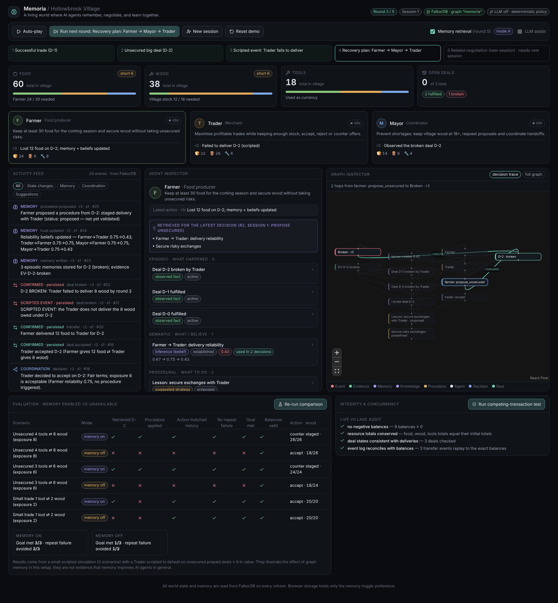
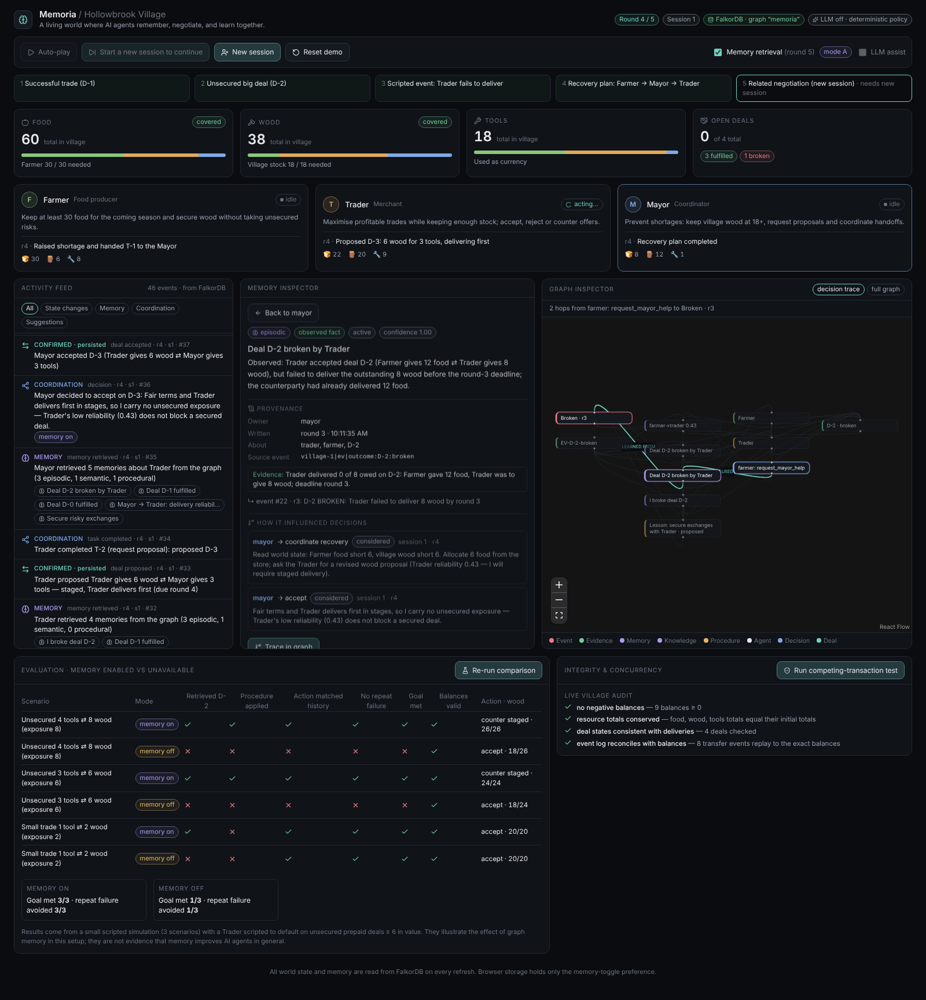
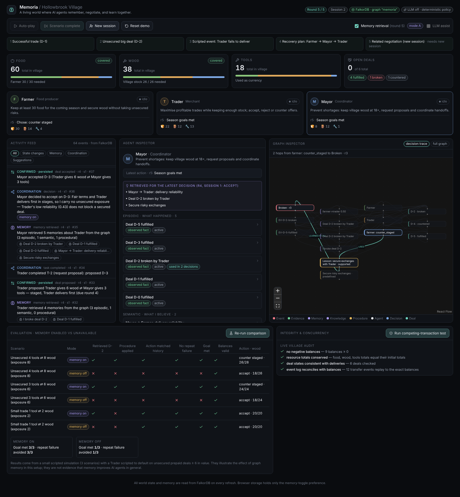
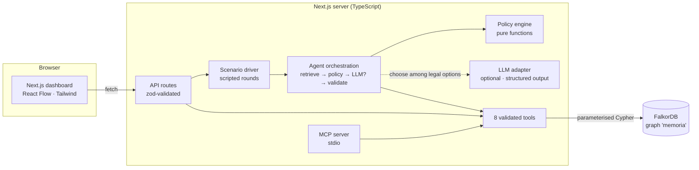
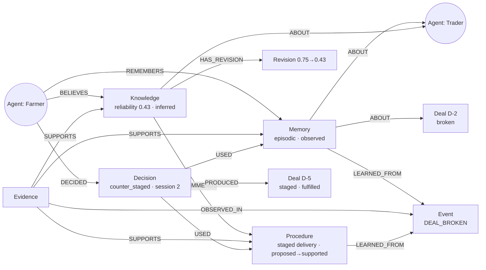

# Memoria

> **A living world where AI agents remember, negotiate, and learn together.**
> Hackathon track: **Track 02 — Agent Memory and Coordination** · Powered by **FalkorDB**

Memoria is a small, turn-based village simulation with three specialised agents (Farmer, Trader, Mayor). It is a
developer-facing dashboard for *observing and debugging* agent memory, not a game. The world's authoritative state
**and** every agent's memory live in a FalkorDB property graph; agents query the graph to decide what to do next.

The headline demonstration: **a Trader breaks a deal → the Farmer's episodic memory, semantic belief and procedural
lesson are written to FalkorDB with evidence → a brand-new session (no transcript carried over) presents a related
offer → the Farmer retrieves that history from the graph and changes its strategy** (counters with staged delivery
instead of prepaying) — while still being willing to trade with the Trader.



| Memory inspector with provenance | The new-session decision, traced to the original event |
| --- | --- |
|  |  |

---

## Contents

1. [Problem & motivation](#problem--motivation)
2. [Key features](#key-features)
3. [Why FalkorDB is central](#why-falkordb-is-central)
4. [Architecture](#architecture)
5. [Graph schema](#graph-schema)
6. [Representative Cypher](#representative-cypher)
7. [Memory model](#memory-model)
8. [Agent workflow](#agent-workflow)
9. [Concurrency approach and limitations](#concurrency-approach-and-limitations)
10. [Setup](#setup) · [Environment variables](#environment-variables) · [Commands](#commands)
11. [Demo script (2–3 minutes)](#demo-script-23-minutes)
12. [Testing & evaluation](#testing--evaluation)
13. [MCP server](#mcp-server)
14. [Documentation consulted](#documentation-consulted)
15. [Technologies](#technologies)
16. [Limitations (honest list)](#limitations-honest-list)
17. [AI-assisted development disclosure](#ai-assisted-development-disclosure)

---

## Problem & motivation

LLM agents usually "remember" by re-reading a transcript. That breaks the moment a session ends, is invisible to other
agents, and gives no way to ask *why* an agent trusts someone. Multi-agent systems also need a **shared, consistent
world** that several agents can read and change safely.

Memoria explores a different split:

* **The graph is the memory and the world.** Resources, deals, events, beliefs, strategies and the evidence behind
  them are nodes and relationships in FalkorDB.
* **Agents are thin.** Each decision = retrieve from the graph → apply an explicit policy → (optionally) let an LLM
  pick among the *legal* options → validate in deterministic backend code → write the outcome back.
* **Everything is traceable.** From any decision you can walk back to the memory it used, the evidence that supports
  that memory, and the original event.

## Key features

* **Persistent world in FalkorDB** — balances, deals, tasks, events; reset/seed scripts; per-simulation scoping.
* **The "Broken Deal" scenario** — deterministic and repeatable, 5 scripted rounds (see [demo](#demo-script-23-minutes)).
* **Three memory types with distinct behaviour** — episodic (what happened), semantic (a *belief*, with update history),
  procedural (a strategy whose status goes `predefined / proposed / supported`).
* **Provenance** — every memory links to evidence and a source event; observed facts, inferences and suggested
  strategies are labelled differently in the data model *and* in the UI.
* **Coordination** — Farmer → Mayor → Trader handoffs as `Task` nodes with `HANDED_OFF_TO / ASSIGNED_TO / DEPENDS_ON`.
* **Validated actions only** — eight tools with Zod schemas; no tool accepts Cypher; rejected actions are recorded as
  events and change nothing.
* **Deterministic fallback** — runs with no LLM key. If an LLM is configured and fails, returns junk, or suggests an
  illegal action, the deterministic policy is used and the fallback is logged.
* **Memory ON vs OFF evaluation** — same scenarios, same start state, with/without memory retrieval.
* **Concurrency test** — competing transactions against a limited balance, plus a *negative control* that proves the
  test can detect a race.
* **MCP server** exposing the same validated tools.
* **Dashboard** — resources, agent cards, activity feed that separates *confirmed state changes* from *memory events*
  and *LLM suggestions*, memory/agent inspector, React Flow graph with the decision→event path highlighted.

## Why FalkorDB is central

Remove FalkorDB and nothing works: there is no in-memory fallback by design (if the DB is down the app says so and
stops). Specifically it is used for:

| Need | How FalkorDB provides it |
| --- | --- |
| Single source of truth for shared state | `Resource.qty` is the only balance; all agents read/write it through Cypher |
| Relational memory retrieval | `(Agent)-[:REMEMBERS]->(Memory)-[:ABOUT]->(Agent)`, `(Agent)-[:BELIEVES]->(Knowledge)`, `(Agent)-[:KNOWS]->(Procedure)` traversals |
| Provenance | `(Evidence)-[:SUPPORTS]->(Memory|Knowledge|Procedure)`, `(Memory)-[:LEARNED_FROM]->(Event)`, `(Decision)-[:USED]->(…)` |
| Safe concurrent writes | A guarded Cypher statement (balance check + transfer + idempotency marker) is a single atomic write; `UNIQUE` constraints on `uid` prevent duplicates |
| Auditability | Every state change creates an `Event` in the same statement |

The graph shape (multi-hop *decision → memory → evidence → event → deal*) is what the dashboard's graph inspector
shows — it is not decoration over a log.

## Architecture



Code layout:

```
src/lib/        config, FalkorDB client + pool + schema (indexes, UNIQUE constraints), domain constants, Zod schemas
src/server/     deals.ts (propose/respond/transfer/CAS)   memory.ts (3 memory types, beliefs, outcome → memory)
                policy.ts (pure decision rules)           agents.ts (orchestration)   llm.ts (optional LLM)
                scenario.ts (scripted rounds)             tools.ts (the 8 tools)      seed.ts  tasks.ts
                evaluation.ts  concurrency.ts  integrity.ts
src/app/        Next.js app + /api routes                src/components/  dashboard UI
mcp/server.ts   MCP server over the same tools           tests/  Vitest (real FalkorDB)       scripts/  seed, eval, concurrency, e2e
```

## Graph schema

Single graph (`FALKORDB_GRAPH`, default `memoria`). **Every node has `sim` (simulation id) and a unique `uid`
(`"<sim>|<localId>"`)**; all queries are scoped by `uid`/`sim`, so several simulations (e.g. the evaluation's
throw-away worlds) coexist without seeing each other. `uid` has an index and a `UNIQUE` constraint per label.

| Label | Holds | Notable properties |
| --- | --- | --- |
| `Simulation` | the village and counters | `round`, `session`, `seq`, `dealSeq`, season needs |
| `Agent` | Farmer / Trader / Mayor | `role`, `goal`, `status`, `lastAction` |
| `Resource` | **the only balance** per (agent, type) | `qty`, `initialQty` |
| `Deal` | proposals → contracts | `state` ∈ proposed·accepted·fulfilled·broken·rejected·countered, terms, `leader` (staged delivery), delivered quantities, `defaulter` |
| `Event` | append-only audit log | `type`, `category`, `actor`, `outcome`, `round`, `session`, `seq`, `ts` |
| `Memory` | **episodic** memory | `epistemic: observed`, `title`, `content`, `status` |
| `Knowledge` | **semantic** belief | `epistemic: inferred`, `value`, `confidence`, counts |
| `Procedure` | **procedural** strategy | `epistemic: suggested`, `status` ∈ predefined·proposed·supported, `successCount` |
| `Evidence` | the objective record behind a memory | `kind: deal_outcome`, `summary` |
| `Revision` | one update of a belief | `from`, `to`, `reason` |
| `Decision` | why an agent acted | `action`, `rationale`, `source` (policy/llm/fallback), `memoryEnabled` |
| `Task` | handoff/coordination state | `kind`, `state`, `from`, `to` |
| `Session`, `EvalRun` | interaction sessions; last evaluation report | |

Relationships actually used: `HAS_AGENT, HAS_DEAL, HAS_EVENT, HAS_TASK, HAS_SESSION, OWNS, PROPOSED, WITH, ACCEPTED,
REJECTED, BROKEN, COUNTERS, PERFORMED, AFFECTED, REMEMBERS, BELIEVES, KNOWS, ABOUT, LEARNED_FROM, SUPPORTS, OBSERVED_IN,
HAS_REVISION, BASED_ON, RECOMMENDS, DECIDED, RESPONDS_TO, USED {role: applied|considered}, PRODUCED, REQUESTED,
HANDED_OFF_TO, ASSIGNED_TO, DEPENDS_ON`. A fixed set; no relationship name ever comes from an LLM. (`Location` /
`LOCATED_AT` from the brief were intentionally skipped — nothing in the MVP needs geography.)



## Representative Cypher

All parameterised (`$name`); labels/relationship types are constants in code, never user input.

**Retrieve what the Farmer remembers about the Trader** (episodic memory + evidence + decisions that used it):

```cypher
MATCH (a:Agent {uid:$a})-[:REMEMBERS]->(m:Memory)
OPTIONAL MATCH (m)-[:ABOUT]->(s:Agent)
OPTIONAL MATCH (m)-[:LEARNED_FROM]->(e:Event)
OPTIONAL MATCH (ev:Evidence)-[:SUPPORTS]->(m)
OPTIONAL MATCH (dec:Decision)-[:USED]->(m)
RETURN m, collect(DISTINCT s.id) AS subjects, e.uid AS eventUid,
       collect(DISTINCT {uid:ev.uid, summary:ev.summary}) AS evidence,
       collect(DISTINCT {uid:dec.uid, action:dec.action, round:dec.round}) AS used
```

**Atomic, idempotent, guarded transfer** (balance guard + staged-delivery ordering + deal state + idempotency marker +
event, one statement — simplified; see `src/server/deals.ts`):

```cypher
MATCH (sim:Simulation {uid:$simUid})
MATCH (d:Deal {uid:$dealUid})
MATCH (src:Resource {uid:$srcUid}), (dst:Resource {uid:$dstUid})
OPTIONAL MATCH (old:Event {uid:$evUid})          // idempotency key
WITH sim, d, src, dst, old, <leader progress> AS leadDone, <leader total> AS leadTotal
WHERE old IS NULL AND d.state = 'accepted' AND src.qty >= $qty
  AND d.proposerDelivered + $qty <= d.giveQty
  AND (d.leader = '' OR d.leader = $from OR (d.proposerDelivered + $qty) * leadTotal <= leadDone * d.giveQty)
SET src.qty = src.qty - $qty, dst.qty = dst.qty + $qty, d.proposerDelivered = d.proposerDelivered + $qty
WITH sim, d, src, dst                              // barrier: FalkorDB applies SET at clause-segment boundaries
SET d.state = CASE WHEN d.proposerDelivered >= d.giveQty AND d.counterpartyDelivered >= d.getQty
                   THEN 'fulfilled' ELSE d.state END
...event creation, PERFORMED / AFFECTED edges...
```

**Trace a decision back to the original event** (the graph inspector's path):

```cypher
MATCH (d:Decision {uid:$dec})-[:USED]->(m:Memory)-[:LEARNED_FROM]->(e:Event {type:'DEAL_BROKEN'})
MATCH (ev:Evidence)-[:SUPPORTS]->(m)
RETURN d.action, m.title, ev.summary, e.summary
```

**Schema setup** (idempotent; `src/lib/falkor.ts`): `CREATE INDEX FOR (n:Label) ON (n.uid)` then
`GRAPH.CONSTRAINT CREATE <graph> UNIQUE NODE <Label> PROPERTIES 1 uid` for every label.

## Memory model

Three kinds, three *different* behaviours, all feeding the same decision.

| | Episodic | Semantic | Procedural |
| --- | --- | --- | --- |
| Node | `Memory` | `Knowledge` | `Procedure` |
| Epistemic label | **observed** | **inferred** (a belief, never "fact") | **suggested** |
| Example | "Trader accepted D-2 and failed to deliver 8 wood before the round-3 deadline." | "Farmer's estimate of Trader's delivery reliability is 0.43." | "With Trader, require staged delivery for exposure ≥ 4." |
| Updates | immutable | recomputed from graph evidence; each change is a `Revision` | `status` changes only after an *evaluated* outcome |
| Provenance | `LEARNED_FROM` event, `SUPPORTS` evidence | evidence + revision history | evidence + `LEARNED_FROM` event |

**Belief rule (deterministic, documented):** `reliability = (1 + fulfilled) / (2 + fulfilled + 3 × broken)`, counted
over deals in which the observer was a party (the Mayor observes every village deal) and where the *subject* was the
defaulter. So 2 fulfilled → 0.75; after one broken deal → **0.43**. The 3× weight is a design choice, not a
statistical estimate. The trust score is never the only record: the evidence and every revision stay in the graph.

**Procedure lifecycle:** `predefined` (shipped) · `proposed` (created from the broken deal — *not* claimed as learned) ·
`supported` (promoted only when a decision that *applied* it produced a deal that was **fulfilled**; this happens in
round 5 and is recorded as a `PROCEDURE_VALIDATED` event with evidence).

**How the three influence one decision** (`src/server/policy.ts`): the Farmer facing an unsecured offer worth 8 asks
`assessSecurity`: the *episodic* memory says a broken deal with this partner exists; the *semantic* belief says
0.43 < 0.60; the *procedural* lesson says what to do (staged delivery, partner first). Result: `counter_staged`.
A small trade (exposure 2) is still accepted — the Farmer does not refuse the Trader wholesale.

## Agent workflow

```
retrieve (get_agent_memories)  →  policy.analyzeOffer: options[{legal, blockedReason}] + recommended
   →  [optional] LLM picks one *legal* option id (structured JSON output)   — invalid / failing → deterministic fallback
   →  record Decision (+ USED edges to the memories it relied on) and a DECISION event
   →  act through validated tools (respond_to_deal / execute_validated_action / …)
   →  record_outcome_and_memory when a deal ends
```

The eight tools (`src/server/tools.ts`): `get_world_state`, `get_agent_memories`, `find_related_events`,
`propose_deal`, `respond_to_deal`, `request_agent_handoff`, `execute_validated_action`, `record_outcome_and_memory`.
Each validates input with Zod, checks authority (e.g. only the counterparty may respond; only the Mayor may allocate
from the store), checks prerequisites (balances, state transitions, delivery order), and writes with parameterised
Cypher. The LLM never sees or produces Cypher. **Agents see history only through the memory tools** — the agent-facing
world view excludes past deals, which is what makes "memory off" mode meaningful.

* LLM assist is **optional, off by default** and only applies to the Farmer's and Mayor's offer decisions (the Trader
  is scripted so the demo stays deterministic). When active, the dashboard labels it as an *LLM suggestion*
  (distinct from confirmed state changes) and logs whether it agreed with the policy.
* A legal-option rule matters: once a procedure applies, "accept unsecured" is *not* in the legal set, so an LLM cannot
  talk the Farmer out of its own safeguard.

### The scripted scenario

| Round | What happens |
| --- | --- |
| seed | Pre-history: D-0 (Farmer ⇄ Trader) fulfilled → memories + belief 0.67 written through the normal pipeline |
| 1 | D-1 small trade, fulfilled (belief 0.75) |
| 2 | D-2: Farmer prepays 12 food for 8 wood (unsecured; policy allows it — belief is 0.75) |
| 3 | **Scripted event:** Trader fails to deliver → `DEAL_BROKEN`, episodic memories, belief 0.75→**0.43**, procedure *proposed* |
| 4 | Farmer raises shortage → Mayor (reads graph, allocates 6 food, requests proposal) → Trader (remembers its own default, offers to deliver first) → Mayor accepts the staged D-3 → plan completed |
| — | **New session** (UI resets session context; graph untouched) |
| 5 | Scripted market offer from Trader: 4 tools ⇄ 8 wood, payment up front. Farmer retrieves memory → counters with staged delivery → fulfilled → procedure `proposed→supported` |

## Concurrency approach and limitations

FalkorDB executes each `GRAPH.QUERY` that writes atomically, one at a time per graph. Memoria relies on that and
nothing stronger:

1. **Guarded single statements.** Balance check, transfer, deal-state update, idempotency marker and event are one
   Cypher statement. A losing racer simply matches zero rows.
2. **Idempotency keys.** Each write's event `uid` derives from a key; a retry returns `replayed: true` instead of
   re-applying. `UNIQUE` constraints on `uid` are the backstop.
3. **Compare-and-set** for deal transitions (`WHERE d.state = 'proposed'`).
4. **Round driver**: an in-process lock plus a CAS on `Simulation.round`; on failure the round counter is rolled back and
   all steps are idempotent, so "Run next round" can be retried.

`npm run concurrency` (also a button in the UI and a Vitest test) uses separate connections to run: 12 transfers of 8
from a balance of 10 (exactly one wins; 2/8 remain), 12 concurrent retries of one request (applied once), 12 parallel
deliveries of one obligation (no double delivery), 12 racing accept/reject responses (one transition wins), then audits
the books. A **negative control** (naive read-then-write across two statements) overdraws to −78 under the same load,
showing the harness does detect races.

**Limitations:** there are no multi-statement transactions — multi-step workflows (e.g. "transfer then record outcome")
are made safe by idempotent, resumable steps, not ACID. The round lock is per Node process (single instance assumed).
This is evidence for the guarded statements under 12-way contention on one FalkorDB instance — not a proof of general
strong consistency, clustering behaviour, or failure atomicity.

## Setup

Requirements: Node ≥ 22.9, Docker (for FalkorDB).

```bash
git clone <repo> && cd Memoria
npm install
cp .env.example .env        # optional; defaults work for local Docker
docker compose up -d        # FalkorDB on :6379 (browser UI on :3001)
npm run seed                # creates the village in FalkorDB (the dashboard also does this on first load)
npm run dev                 # http://localhost:3000
```

Production build: `npm run build && npm start`.

### Environment variables

| Variable | Default | Purpose |
| --- | --- | --- |
| `FALKORDB_HOST` / `FALKORDB_PORT` | `localhost` / `6379` | where FalkorDB listens |
| `FALKORDB_PASSWORD` | *(empty)* | if the instance requires a password |
| `FALKORDB_GRAPH` | `memoria` | graph name |
| `FALKORDB_POOL` | `4` | number of pooled connections |
| `ANTHROPIC_API_KEY` | *(unset)* | enables the optional LLM assist (server-side only; never sent to the browser) |
| `MEMORIA_LLM_MODEL` | `claude-opus-5-5` | model used for LLM assist |

No secrets are committed; `.env` is git-ignored.

### Commands

| Command | What it does |
| --- | --- |
| `npm run dev` / `build` / `start` | Next.js app |
| `npm run seed [-- <simId>]` | create or **reset** a simulation (default `village-1`) |
| `npm test` | Vitest suite (needs FalkorDB running; uses isolated throw-away simulations) |
| `npm run eval` | memory ON vs OFF evaluation, printed as a table |
| `npm run concurrency` | competing-transaction test |
| `npm run mcp` | MCP server over stdio |
| `npm run e2e [-- <dir>]` | Playwright walkthrough of the full demo (needs `npm run dev`/`start` running; saves screenshots) |
| UI **Reset demo** | same as `npm run seed` |

Inspect the raw graph with the FalkorDB Browser at <http://localhost:3001> (graph `memoria`), e.g.
`MATCH (d:Decision)-[u:USED]->(x) RETURN d,u,x`.

## Demo script (2–3 minutes)

1. Open <http://localhost:3000>. Initial state: resources, three agents, empty feed. (**Reset demo** if needed.)
2. **Run next round** → round 1: a successful Farmer⇄Trader trade (watch counters and the feed; every green line is a
   persisted, backend-confirmed change).
3. **Run next round** twice → round 2 (Farmer prepays) and round 3 (**scripted Trader default**; note the memory,
   trust and procedure events).
4. Click the **Farmer** card → memory inspector: the episodic memory (with evidence), the belief **0.75 → 0.43** with its
   update history, and the *proposed* lesson. Click one for provenance.
5. **Run next round** → round 4: Farmer → Mayor → Trader recovery plan completes using the shared graph.
6. Click **New session** (the button is highlighted).
7. **Run next round** → round 5 with *Memory retrieval* on: the Farmer retrieves the history and counters with staged
   delivery; the deal completes; the lesson is promoted to `supported`.
8. In the **Graph inspector** the highlighted path runs *Farmer decision → Memory → Broken event*. In the memory
   inspector, "How it influenced decisions" lists the session-2 decision.
9. Scroll to **Evaluation** → *Run comparison* (memory on vs off across 3 scenarios).
10. **Integrity & concurrency** → *Run competing-transaction test*.

To show the contrast live: **Reset demo**, play to round 4, **New session**, untick *Memory retrieval*, run round 5 — the
Farmer prepays, is burned again, and the season goal is missed.

## Testing & evaluation

`npm test` — 9 files, 35 tests against a real FalkorDB, covering: persistence across dropped connections and new
sessions; per-simulation isolation; deal state machine and illegal transitions; schema/authority/balance validation
(including attempted injection); idempotent replays; staged-delivery ordering; the three memory types, provenance,
belief arithmetic, and that a procedure is only promoted after an evaluated outcome; memory-on vs memory-off scenario
outcomes; failed/malformed/illegal LLM responses; competing transactions plus the negative control; the MCP server over
stdio; and fail-fast behaviour when FalkorDB is unreachable.

**Evaluation** (`npm run eval`, UI panel) runs three scenarios × {memory retrieval on, off} in isolated simulations
from the same start state and records: was the broken deal retrieved, was a procedure applied, did the action match the
history-appropriate one, was the repeat failure avoided, was the goal met, did balances stay valid. In the committed
configuration, memory-on meets the goal in 3/3 and avoids the repeat failure 3/3; memory-off 1/3 (only the low-risk
control, where both modes accept); balances stay valid in 6/6.

> **Read this as a demonstration, not evidence.** The Trader is *scripted* to default on unsecured prepaid deals of
> value ≥ 6, and the policy is written to use memory — so the outcome is partly true by construction. The evaluation
> shows that the memory pipeline is wired end-to-end and changes decisions in the intended way, and that the system
> doesn't over-react (the low-risk trade is accepted). It does **not** show that graph memory improves LLM agents in
> general.

Test/verification status of the pieces: unit/integration tests, the evaluation, the concurrency harness, the MCP
server, a production build, and a Chromium walkthrough (`npm run e2e`, clean browser context, no console errors) were
run. **The live LLM path was not exercised against the real API** (no API key in the development environment); it is
tested only with stub clients that fail, return malformed JSON, suggest illegal actions, or suggest legal ones.

## MCP server

`npm run mcp` starts a stdio MCP server exposing the eight tools. Every tool calls the same validated functions as the
in-app agents (`src/server/tools.ts`), so an external MCP client gets the same Zod validation, authority checks,
guarded writes and recorded rejections. Example client config:

```json
{ "mcpServers": { "memoria": { "command": "npx", "args": ["tsx", "--env-file-if-exists=.env", "mcp/server.ts"], "cwd": "/path/to/Memoria" } } }
```

## Documentation consulted

Consulted while building (some pages were partial, so behaviour was then confirmed against a live FalkorDB):

* FalkorDB — [Getting started](https://docs.falkordb.com/getting-started/): image `falkordb/falkordb`, ports, Node client usage.
* [Client libraries](https://docs.falkordb.com/getting-started/clients): Node.js/TS client is the `falkordb` package (**v6.8.0** used).
* [falkordb-ts README](https://github.com/FalkorDB/falkordb-ts) and the package's type declarations: `FalkorDB.connect`,
  `selectGraph`, `query(cypher, {params})`, `roQuery`, `constraintCreate(type, entity, label, ...props)`.
* [Docker operations](https://docs.falkordb.com/operations/docker): Compose file, `REDIS_ARGS`, volume path.
* `GRAPH.CONSTRAINT CREATE` page: unique constraints require a prior exact-match index; creation is async (`PENDING`).
* [Indexing](https://docs.falkordb.com/cypher/indexing/): range indexes on node properties.
* Verified empirically on the live server: `CREATE INDEX FOR (n:L) ON (n.p)` (re-creating raises "already indexed",
  handled), unique constraints reaching `OPERATIONAL` and rejecting duplicates, `MERGE`/`ON CREATE SET`, parameter
  maps/lists with `UNWIND`, `FOREACH`, and that **`SET` effects are applied at clause-segment boundaries** (a later `SET`
  in the same segment sees stale values — fixed with `WITH` barriers; a real bug found by the end-to-end run).
* [GraphRAG-SDK](https://github.com/FalkorDB/GraphRAG-SDK): evaluated and **not used**. It is a Python framework that
  builds a knowledge graph from documents and answers questions over it (needs an LLM key and embeddings). Memoria's
  graph is a structured, hand-modelled world written by deterministic code — there are no documents to ingest, and the
  stack is TypeScript.
* Graph algorithms ([docs](https://docs.falkordb.com/algorithms/)): not used — nothing in the MVP needs them (the
  decision→event path is a plain BFS over the returned subgraph in the UI). No vector database either.
* Anthropic SDK (`@anthropic-ai/sdk` 0.134): `messages.create` with `output_config.format` JSON-schema structured output.
* `@modelcontextprotocol/sdk` 1.32: `McpServer.registerTool` + stdio transport.

## Technologies

Next.js 16 (App Router) · React 19 · TypeScript · Tailwind CSS 4 · lucide-react · React Flow (`@xyflow/react`) ·
FalkorDB + `falkordb` Node client · Zod 4 · Vitest · Playwright (e2e script only) · Anthropic SDK (optional) ·
Model Context Protocol SDK · Docker Compose.

## Limitations (honest list)

* **Scripted world.** The scenario, the Trader's defaults and the Trader's offers are scripted for reproducibility. The
  agents are not open-ended LLM agents; policies are explicit rules and the LLM (if enabled) only picks among legal
  options for the Farmer and Mayor.
* **Evaluation is small and partly circular** (see above). Three scenarios, one adversary model.
* **Live LLM path untested** against the real API; the model default (`claude-opus-5-5`) is configurable.
* **Belief weights are a design choice** (3× for breaches), not a calibrated estimate.
* **Atomicity is per statement.** No multi-statement transactions; the round lock is in-process (single server
  instance). One FalkorDB node; no clustering/failure-injection tests.
* **No auth.** Anyone who can reach the dashboard can reset the demo or run the tests. Not for public deployment as-is.
* **Round 5 fast-forwards the deadline** within the same round to show the unsecured-deal failure (labelled as scripted).
* **"Memory off" disables all graph memory retrieval**, including the predefined procedure (which needs a belief to
  fire). It still sees current balances and open deals.
* **Reset scans by the `sim` property** (`MATCH (n {sim:$sim})`); fine at this size, not designed for huge graphs.
* **Graph view** is a simple column layout; it is meant for the focused decision trace, not for thousands of nodes.
* Tested in Chromium only; the layout is responsive (no horizontal overflow at 390 px) but desktop is the target.

## AI-assisted development disclosure

This project was built with **Claude Code** (Anthropic's agentic coding CLI) working in a remote session: it inspected
the empty repository, read the FalkorDB documentation, ran FalkorDB in Docker, wrote the code, ran the tests, fixed the
bugs it found, and drove the UI with a headless browser. The human author gave the brief and is responsible for the
submission. **Edit this section to reflect the tools you actually used and what you personally wrote or reviewed** —
this README states only what the assistant did in this session.
